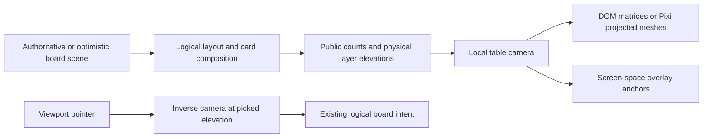

# Board depth: research and production implementation

Date: 2026-10-10. Scope: presentation, picking, pile height, local settings, and integration into the existing sandbox.

(2026-10-28: the Pixi renderer described here was retired, ADR-004; depth lives in the DOM table only.)

**Production status:** depth is integrated into live rooms in both DOM and Pixi renderers. Open Settings → Table depth to select Flat, Raised cards, or Tabletop. Flat remains the default. The research study and its original rollout plan below are retained for context; the production integration section records the delivered implementation.

## Recommendation

Use a shallow projected table with individually elevated cards: approximately 8–10° of tilt, small sleeve edges, contact shadows, and a short lift when picking up a card. Keep the hand, inspection dialogs, controls, menus, and numeric labels in screen space. Offer **Flat**, **Raised**, and **Tabletop** views. Raised adds thickness without perspective foreshortening and is a useful middle ground for readability.

The most valuable depth cues are changing deck/discard height, separation between evolution layers, the shadow detaching during a drag, and a consistent light direction. A large camera angle makes the distant cards smaller and competes with the sandbox's need to read and manipulate everything. Neither a full physics engine nor a migration to a general 3D engine is necessary for these effects.

The study is available on the Vite development server at `/?depth-lab=1`. It uses sample public artwork, has no room connection, and persists only its own display preferences. The entry and import are guarded by `import.meta.env.DEV`; production builds omit the lab.

## What the references actually show

### Pokémon TCG Live

The official September 15, 2026 developer letter describes a stadium board, a landscape arrangement closer to physical play, and camera/layout adjustments for card legibility. It also mentions adjustable visual effects. It does **not** publish camera parameters, pile geometry, or animation implementation. [Official developer letter](https://community.pokemon.com/en-us/discussion/26006/letter-to-the-community-september-15-2026).

I inspected the accompanying official board image. My visual reading is that the environment, rim, lighting and shadows supply much of the dimensional feeling, while the card faces remain relatively readable. The promotional image itself is presented at an angle, so measuring a camera tilt from that image would be misleading. This research does not claim to have measured Live's draw/shuffle timing from that still. [Official board artwork](https://us.v-cdn.net/6034460/uploads/UXE9UQ3EZ6H2/rain-r42-cpn26-14-popup-news-ngbb-keyart-16x9-social.png).

### CABT in `mew-world-order`

Read the adjacent checkout at revision `245a9e9c`, particularly:

| File under `viewer/app/src/`           | Finding to reuse                                                                                                                                                                                                                           |
| -------------------------------------- | ------------------------------------------------------------------------------------------------------------------------------------------------------------------------------------------------------------------------------------------ |
| `state/viewSettings.svelte.ts`         | Defaults: 8° tilt, 1250px perspective, 94% vertical scale, zero lift.                                                                                                                                                                      |
| `lib/components/ViewerSettings.svelte` | Exposes tilt 0–18°, perspective 700–2200px, vertical scale 86–100%, and lift −48–48px. Useful tuning controls, more than the final simulator settings need.                                                                                |
| `lib/components/GameBoard.svelte`      | Board plane is transformed separately from the hands and interface. Uses perspective origin 50% 68%. Its source explicitly documents detached Chromium hit regions with nested `preserve-3d`, and deliberately flattens the board context. |
| `lib/components/CenterPiles.svelte`    | Decks use at most eight decorative card-back layers. Layer count is `ceil(count / 8)`, bounded to 1–8 for nonempty piles. Layer offsets are 2D translations; this is a convincing pile illusion, not a physical 60-card mesh.              |
| `lib/dom/planeGeometry.ts`             | Maintains separate board/viewport coordinate spaces, reconstructs the plane quad, solves a projective mapping, and provides a matrix for animation crossing between the hand and board.                                                    |

CABT's important lesson is its coordinate discipline. Copying the board CSS without the inverse mapping would create inaccurate dragging. Its eight-layer pile is economical, but height changes only at count thresholds. Our pile's target height should change on every draw while the number of decorative edge primitives stays bounded.

CABT's own workaround is evidence about that implementation, not a claim that CSS 3D is universally broken. The platform independently has flattening rules: overflow, filters, opacity and paint containment can flatten descendants even when `preserve-3d` is specified. That matters because our current board already uses clipping and containment. [MDN transform-style](https://developer.mozilla.org/en-US/docs/Web/CSS/Reference/Properties/transform-style), [CSS Transforms Level 2](https://drafts.csswg.org/css-transforms-2/#3d-rendering-contexts).

## Fit with our current renderer

The current production default is **React DOM**, with Pixi available as the alternate renderer. [ADR-027](../ADR-027-EXPERIENCE-REDESIGN.md) retains DOM in part because arbitrary external card images may display in an `` while lacking the CORS permissions required for a WebGL texture. Depth should not silently make those decks stop displaying.

| Approach                                                                       | Advantages                                                                                                         | Costs / judgment                                                                                                                                            |
| ------------------------------------------------------------------------------ | ------------------------------------------------------------------------------------------------------------------ | ----------------------------------------------------------------------------------------------------------------------------------------------------------- |
| One CSS perspective transform on the whole existing board                      | Quick visual sketch                                                                                                | Existing pointer ratios, overlay drops, clipping and animation endpoints become wrong. Good for a screenshot, insufficient as the integration.              |
| Shared camera math → individual DOM image matrices and projected edge polygons | Retains native image loading, focus and pointer targets; no nested 3D context; exact shared projection and inverse | More geometry work than a single CSS transform. Needs deliberate paint ordering and animation integration. **Prototype and recommended first integration.** |
| Shared camera math → Pixi `PerspectiveMesh` faces and edge geometry            | Same camera model; shader/material opportunities; can batch geometry                                               | Requires texture/CORS strategy, mesh hit testing, and profiling. A supported second rendering path rather than a prerequisite.                              |
| Full Three.js/Babylon/physics scene                                            | Arbitrary camera orbits, true intersections and complex lighting                                                   | New asset, input, accessibility and rendering systems. Excessive for a restrained board effect. Reconsider only if the product wants a free 3D tabletop.    |

Pixi v8 supplies `PerspectiveMesh`, including four-corner updates and perspective-correct texture mapping. I also verified `PerspectiveMesh.setCorners` in the installed **8.20.1** package rather than assuming the latest online API matches our dependency. A subdivided plane is useful for material effects; a sprite's affine skew alone cannot represent a trapezoid accurately. Pixi's mesh facilities do not automatically supply a complete 3D camera, scene depth sorting or ray picking. [Pixi mesh guide](https://pixijs.com/8.x/guides/components/scene-objects/mesh).

## Primitives added in this pass

[`table-camera.ts`](../../../../packages/renderer-contract/src/table-camera.ts) is renderer-independent and has no browser or game-state dependency. It provides a bounded camera, forward projection, inverse projection at a known elevation, card corner projection, the equivalent CSS matrix, and pile height.



The logical board remains the source for positions, zones and commands. Camera tilt, perspective, card height and shadows are presentation data. A player's preference never changes their opponent's view or the authoritative state.

The camera looks down on a horizontal board. For tilt `a`, relative board coordinates `(x, y)` and height `z`, its perspective denominator is:

```text
w = 1 - (y × sin(a) + z × cos(a)) / distance
screenX = centerX + offsetX + scale × x / w
screenY = centerY + offsetY + scale × (y × cos(a) - z × sin(a)) / w
```

The implementation includes a small oblique offset for Raised mode, which otherwise uses orthographic projection. Tabletop uses a distance tied to viewport size, avoiding a wildly different field of view in a smaller window. Fit considers the board corners at both zero and the configured maximum elevation. Flat is the exact identity mapping.

Card images, edge polygons and pointer inversion use the same model. DOM matrices are obtained directly from that projection; the lab does not measure a transformed bounding rectangle and pretend it is the plane. The first version covers horizontal card surfaces and in-plane quarter turns. Arbitrary card pitch/roll would require extending both the face projection and ray/plane intersection together.

### Height and physical composition

The prototype uses an art-directed thickness proportional to card width:

```text
single-card thickness = cardWidth × 0.0055 × depthStrength
pile height = effectiveCount × single-card thickness
effectiveCount = count                                      when count ≤ 60
effectiveCount = 60 + min(60, 20 × ln(1 + (count - 60) / 20)) otherwise
```

This is a visual scale, not a claim about the millimetre thickness of real sleeves. At card width 100 and strength 1, counts 1 / 10 / 30 / 60 have world heights 0.55 / 5.5 / 16.5 / 33. A shallow camera makes the visible edge much smaller than those world heights. Large sandbox piles compress smoothly and are capped; the count badge always remains exact.

| Object                          | Height and representation                                                                                                                                    |
| ------------------------------- | ------------------------------------------------------------------------------------------------------------------------------------------------------------ |
| Deck                            | One visible sleeve face at public-count height, four neutral side polygons, at most eight edge bands. Never render hidden identities as side layers.         |
| Discard / Lost Zone             | Public-count height; the top permitted face stays visible. Only explicitly displayed fan cards need separate faces.                                          |
| Ordinary card / Prize           | One card thickness and a contact shadow. A face-down card still has neutral edges.                                                                           |
| Evolution stack                 | Each physical card adds one thickness. Keep the existing exposure/offset of the lower cards.                                                                 |
| Tools / Energy                  | Separate physical layers, with the existing attachment offset; no inferred game legality. Head Ringer ownership must not be changed by visual attachment.    |
| LEGEND, V-UNION, joined Stadium | Joined pieces occupy a shared plane. Four V-UNION pieces are **one layer**, not a stack four cards tall. Elevation is separate from composition piece count. |
| BREAK                           | The landscape overlay sits above the base card; retain its upper-half exposure and group drag.                                                               |
| Damage / condition markers      | Small extruded tokens on the top layer; keep the numeral upright and accessible. Do not multiply visible tokens without a bound.                             |

The lab demonstrates both deck counts, discard piles, individual Prizes, evolution layers, BREAK, and a joined V-UNION. The token, attachment and other joined-format treatments above are integration recommendations, not additional implemented lab features. The depth lab's hand caps displayed samples at seven; its draw control demonstrates height changes, not a full deck workflow.

### Dragging, animation and optimism

When picking up a card, intersect the cursor ray with its currently painted elevation and retain that exact grip point. When lifted, intersect at the new elevation and solve for the object's translation. Every member of a joined group shares that translation. The prototype tests an off-center grip at maximum tilt, both while lifted and after release, to within one screen pixel.

The first production version should use the existing motion director to animate elevation and contact shadow alongside position. One animator owns a card's pose. Do not add a second CSS transition competing with the existing position spring or board flip. Shadows should widen and soften as a card lifts, with a restrained directional offset; faces can have a light sleeve rim. Material glare should respond to the card/light relationship without obscuring text. Per-card tilt and board parallax should be later, optional additions after picking is correct.

Height follows the **displayed scene**, including optimistic public counts, immediately. The authoritative acknowledgement must not replay the same draw animation. A rejection/rebase retargets from the current visible height to the corrected target; it never waits for a visual animation queue. Hidden-tab resume, reconnect and replay seek snap to the current scene. None of this needs a new room command or server-side height.

The lab's 180ms height easing is interruptible and has no idle animation loop. It uses the existing motion duration/reduction settings. Drag tracking is direct, not delayed by that easing. Lift/drop itself is immediate in this small study; smooth pickup/settle choreography and hand-to-deck flights still belong in the production motion director.

### Settings

Recommended final settings, stored per browser rather than in match state:

| Setting               | Initial behavior                                                                                                                                            |
| --------------------- | ----------------------------------------------------------------------------------------------------------------------------------------------------------- |
| Table view            | Flat / Raised / Tabletop. Keep Flat as the production default until the integrated interactions pass the gates below. Lab opens in Tabletop for comparison. |
| Table angle           | Advanced control, 0–18°, starting at 8–10°. Only relevant to Tabletop.                                                                                      |
| Depth amount          | Start at 1×, bounded 0–2× during tuning. Zero removes physical thickness.                                                                                   |
| Lift while dragging   | Separate toggle; reduced motion suppresses lift.                                                                                                            |
| Animate stack changes | Separate toggle; follows shared animation speed and reduced-motion preference.                                                                              |
| Pointer parallax      | Future option, initially off. Tiny bounded motion; no idle camera drift.                                                                                    |

Static depth can remain enabled with reduced motion. Camera travel, hover bobbing, drag lift and animated changes should stop. Directly dragging a card must remain possible. This is consistent with providing a way to disable nonessential interaction-triggered animation; it is not a claim of full accessibility conformance. [W3C guidance](https://www.w3.org/WAI/WCAG22/Understanding/animation-from-interactions.html).

## Original integration plan

The lab intentionally makes the visual choice reviewable before replacing the live board's coordinate system. These are the production call sites that must move together:

| Area                                                   | Required change                                                                                                                                                                                          |
| ------------------------------------------------------ | -------------------------------------------------------------------------------------------------------------------------------------------------------------------------------------------------------- |
| `renderer-contract` scene/layout                       | Keep logical bounds unchanged; derive physical layers from public piles and composition. Provide a camera snapshot and projected bounds/anchors.                                                         |
| `renderer-dom/BoardSurface.tsx`                        | Replace linear viewport-to-board mapping for pointer and wheel paths; replace AABB-based `localPointer` for projected card grips. Draw projected faces and thickness with stable keys.                   |
| DOM motion director and drag swing                     | Compose animated pose with camera projection once. Integrate z and shadows. Keep canceled drags, modifier changes and interrupted animation deterministic.                                               |
| `renderer-pixi/PixiBoardRenderer.ts`                   | Replace the assumption that `event.global` is logical board space. Render perspective-correct faces, use projected-quad hit testing and inverse mapping, and keep material/texture policy explicit.      |
| `LegacyBoardOverlays.tsx`                              | Update `openedZoneDropPoint`, native overlay drags, and source/target animation anchors. Deck browsers and modal card reading remain screen-space surfaces.                                              |
| `RemoteSessionBoard.tsx` and board chrome              | Keep renderer, overlay host and chrome as separate spaces. Project zone/card anchors without tilting buttons, text fields, menus or dialog portals.                                                      |
| `RemoteRoomSettings.tsx`, preferences and motion store | Add validated local depth preferences. Apply camera changes as a single view update; cancel or safely rebase active pointer gestures.                                                                    |
| Board flipping, solo seat changes and replay           | Change logical seat/layout atomically, then animate the view. Prefer a restrained transition or fade. A theatrical 180° tumble would expose backward cards and impair orientation. Reduced motion snaps. |
| Optimistic projection and reconnect                    | Existing logical commands stay unchanged. Stable render keys prevent an acknowledgement from remounting a pile face. Tests must exercise rollback and resync with depth enabled.                         |

Avoid sorting faces solely by a CSS z-index proportional to height: a low card closer to the camera can cover a higher card farther away. Production needs stable scene paint order, attachment/group order, and a separate dragged-object layer. The lab uses explicit sample layers, so arbitrary overlapping multi-pile occlusion is not established by its tests.

Preserve board symmetry in **logical** space. Perspective intentionally makes the distant side slightly smaller; separately translating each Active container to force identical screen rectangles would break the shared table plane. The two Active centerlines remain aligned.

## Original study validation and rollout gates

Implemented tests in this pass:

- Camera round trips across three modes, viewport widths, angles and elevations; exact Flat identity; elevated viewport fit; DOM-matrix/quad agreement for all four orientations; lifted grip preservation; malformed input handling; monotonic and bounded pile heights.
- Browser interactions: decrement/empty/reset, preference persistence, off-center lifted drag, V-UNION seams and grouped motion, Escape/resize cancellation, keyboard movement, dialog focus return, landscape BREAK inspection, reduced motion, and viewport containment at 1440×1000, 1024×768 and 724×768.
- Separate visual inspection with actual card artwork: Tabletop and Raised at 1440×1000, Tabletop at 1024×768, and a readable landscape BREAK modal. Automated geometry tests use deterministic local responses for remote art.

Production acceptance still requires the real room interactions at multiple DPRs and zoom levels, fullscreen/sidebar changes, both seats, deck-browser/native drags, context menus and tooltips, touch and pen, camera changes during a drag, out-of-window cancellation, undo/rebase/reconnect/replay, and hidden-information checks. Chromium and Firefox alone do not establish Safari behavior.

Performance goals must be measured on real hardware: idle should schedule no depth frames, pile cost should not grow with hidden card count, pointer-to-paint should stay within the target frame budget, and a full 60-card reveal must avoid an unexpected image decode/mesh burst. Reuse geometry and shadows in the production renderer; the lab's per-object SVG wrappers are intentionally simple research scaffolding, not a completed batching strategy.

Roll out in order: (1) choose the visual preset in the lab; (2) public pile height and shadows in Raised mode; (3) camera and all coordinate consumers together behind the setting; (4) motion-director integration for lift, flights and flip; (5) optional parallax/material polish. Each stage has an immediate Flat fallback and preserves the manual sandbox.

Run evidence and screenshots for this session are under `/tmp/ptcg-board-depth/`.

Final results for this pass:

| Check                                              | Result                                                                                   |
| -------------------------------------------------- | ---------------------------------------------------------------------------------------- |
| Camera, composition and composed-scene unit suites | 24 passed, including 10 new camera/height tests                                          |
| Depth lab browser scenarios, Chromium              | 6 passed                                                                                 |
| Same scenarios, Firefox                            | 6 passed                                                                                 |
| `check:static:v2`                                  | Passed: formatting, lint, source boundaries, reviewed API surface, cycles and TypeScript |
| `build:v2`                                         | Passed: web build, worker dry run and bundle boundaries                                  |
| Production JS/CSS inspection                       | No depth-lab route, component or style content emitted                                   |
| `git diff --check`                                 | Passed                                                                                   |

These results validate the camera primitives and the isolated study. They do not establish production-room perspective support or an audit of every existing page.

## Production integration

### Shared projection and input

`renderer-contract/board-depth.ts` derives elevations from recipient-safe scenes, including optimistic public counts. Decks, discard piles and the Lost Zone use one face and bounded neutral edge geometry; there is no object per hidden card. Evolution and attachment layers acquire thickness. Joined LEGEND, V-UNION and Stadium pieces share a physical plane; BREAK retains its overlapping layer and existing artwork orientation.

The camera affects the mat, zones and card faces. Hands, menus, inspectors and controls remain readable screen-space surfaces. Card and marker anchors, native browser/work-area drops and pointer targeting all use the same projection. During a flight or shuffle, input inverts the last painted face, retains the off-center grip and converts the result into the existing logical command coordinates. The floating toolbar sits between the projected Active containers so it does not cover an Active card on a narrow table.

`TablePoseMotion` owns interruptible position, rotation, plane, elevation and thickness interpolation. A hand-to-table flight blends between the flat hand and the table camera. New targets retarget the currently visible pose; an unchanged authoritative acknowledgement does not start another flight. Layout changes, replay replacements and view switches stop stale movement. Camera changes cancel active gestures before installing new preferences. Resizing, Escape and window suspension have explicit cancellation paths.

### Rendering and cost

The DOM renderer uses one projected matrix per physical face, stable SVG paper edges and a contact shadow that moves with elevation. The depth director paints only changing poses and drives flights, face changes and bounded shuffle copies from one on-demand animation clock. Card components receive a camera and their own pose rather than the entire scene projection. Immutable value keys let acknowledgements reuse unchanged card faces and SVG paths, even when the server projection recreates descriptor objects. It does not trigger React renders on animation frames. The Pixi renderer uses 4×4 `PerspectiveMesh` faces, projected polygon hit areas and neutral edge geometry with the same camera and timing primitives. Pixi shuffle copies hold texture leases only for their lifetime and release meshes, graphics and leases on completion, cancellation or renderer destruction. Switching view modes retains the existing card texture leases.

Piles have at most eight decorative edge bands. The logical count remains exact, including unusually large sandbox piles, while height compresses above 60 cards. A held top card leaves a stationary pile underneath. When a private card alias changes on release, the departing face starts at its last painted release position and the newly exposed pile cover stays home. Its underlay is reused while dragging in Pixi; neither renderer draws concealed card identities on pile edges. Existing image loading and CORS policy is unchanged.

No depth animation clock runs while the settled table is idle. Shadows are bounded and there is no real-time light simulation, depth buffer, physics engine, scene-wide blur pass or new rendering dependency. Headless browser evidence is useful for resource stability and interaction correctness, but is not a claim of a particular GPU frame rate on players' hardware.

### Preferences and accessibility

Settings expose the three view modes, 0–18° table angle, 0–2× thickness, drag lift and stack-height animation. Choices are validated, persisted per browser and never serialized into a match or sent to an opponent. Unavailable or malformed local storage falls back safely. Reduced motion and instant speed preserve static depth while disabling animated travel and drag lift. Card reading remains in the existing full-size, flat inspectors and dialogs. Depth uses neutral edges rather than text or labels derived from private pile contents.

The visual review also caught and fixed a double-click passing from a deck into its newly opened browser. A preview now requires a double-click that started on that browser card.

### Production validation

Run logs, inspection screenshots and performance/resource evidence are in `/tmp/ptcg-board-depth/`. The isolated lab remains a development-only comparison tool and is not required by production rooms.

The broad Chromium run completed with **232 passes and one failure** in an existing keyboard attachment test. Its helper clicked the first exposed edge pixel, which could move under the hover spring. Three isolated repeats passed; the helper was then changed to prefer an exposed interior point, and all **17 tests in that file passed**. This is a corrected rerun, not a claim that the original full run was clean. That broad run also completed the six-minute Solo setup/reset soak and renderer lifecycle/cache checks.

A subsequent 19-case Chromium run passed 18 cases but missed one Flat-mode joined-card drop. That scenario then passed three isolated repetitions and the corresponding Firefox and WebKit runs. The final complete 19-case Chromium rerun also passed (`chromium-verified.log`). No product cause was reproduced; this intermittent result is retained in `chromium-final.log` and `joined-flat-recheck.log` rather than erased by the reruns.

The final depth-specific checks cover real-room draw/play, deck-top release across private aliases, stationary pile underlays, off-center grabs at 18°, Escape/blur/resize cancellation, native deck-browser drops, damage markers and menus, reduced motion, saved preferences, optimistic feedback, and joined-card seams/rotation/board flips. The narrow viewport check verifies both toolbar clearance and zero accidental surface scrolling. Repeated Flat/Raised/Tabletop switches and shuffles return Pixi textures and display objects to their settled baseline. Idle-frame assertions require zero renderer frames after settling.

| Final integration check                                               | Result                                                                                   |
| --------------------------------------------------------------------- | ---------------------------------------------------------------------------------------- |
| Full V2 unit suite                                                    | 279 files, 2,698 tests passed                                                            |
| Formatting, lint, boundaries, API, cycles and TypeScript              | Passed (`static-final.log`)                                                              |
| Production web/worker build and bundle boundaries                     | Passed (`build-final.log`); no depth-lab content in production JS/CSS                    |
| Live depth, special-card and optimistic interaction suites — Chromium | 19 passed on the final full rerun (`chromium-verified.log`)                              |
| Live depth, special-card and optimistic interaction suites — Firefox  | 19 passed (`firefox-verified.log`)                                                       |
| Same suites — Linux WebKit                                            | 19 passed (`webkit-verified.log`)                                                        |
| Development depth lab                                                 | Six scenarios passed in each of Chromium, Firefox and WebKit earlier in this integration |
| DPR 2                                                                 | Two Chromium checks passed (`dpr2-live.log`)                                             |
| Patch whitespace                                                      | `git diff --check` passed                                                                |

An additional forced WebGL loss during a Tabletop flight recovered to one canvas, 49 texture bindings and the same 190 display objects, with the camera setting retained and motion settled (`context-depth.log`).

Linux Chromium, Firefox and WebKit runs establish behavior in those engines. WebKit used Mesa software rendering and locally extracted runtime libraries; this is not an on-device Safari certification. The separate DPR 2 checks cover DOM off-center input and a Pixi room interaction, not every browser zoom level or physical input device.

### Performance evidence and limits

A diagnostic renders 120 visible faces with reused image URLs, warms each view, then measures 25 single-card and 25 full-scene updates per mode. It runs on the Vite development build in headless Chromium with SwiftShader. The incremental version passes an explicit scene cause and uses instant motion to isolate scene installation from travel. Its timings include React development instrumentation and browser scheduling; they are **not GPU frame-rate measurements**.

Profiling found expensive React development inspection of a whole-board projection passed into each card. Passing only the camera, pose and pile band count, memoizing equivalent card values, and skipping unchanged edge writes removed that redundant work. The early replacement diagnostic was substantially slower and should not be presented as live incremental performance. The optimized incremental run is recorded in `depth-performance-incremental.json`; a full 120-face DOM rewrite remains more expensive than a single-card update or the Pixi path. No settled mode scheduled idle commits, and 120 Pixi faces retained exactly 120 local texture bindings through the measurement.

Latest diagnostic scene-install times, milliseconds (median / p95):

| Renderer | View         | One changed face | All 120 changed faces |
| -------- | ------------ | ---------------- | --------------------- |
| DOM      | Flat         | 4.2 / 10.9       | 6.9 / 14.2            |
| DOM      | Raised cards | 4.6 / 15.0       | 26.6 / 86.4           |
| DOM      | Tabletop     | 4.8 / 15.5       | 27.0 / 65.0           |
| Pixi     | Flat         | 1.4 / 2.8        | 1.3 / 2.4             |
| Pixi     | Raised cards | 8.6 / 21.7       | 6.4 / 23.1            |
| Pixi     | Tabletop     | 6.5 / 14.7       | 7.1 / 12.4            |

Real-device pointer-to-paint profiling, touch/pen ergonomics and Safari device testing remain useful follow-up validation. Optional camera parallax and arbitrary per-card pitch/roll are outside this implementation; the delivered effect is a shared table perspective with physical heights and in-plane card motion.

## Pre-commit review — 11 October 2026

The final review covered the accumulated experience, special-card and depth changes, including recipient-safe artwork, cross-owner attachments, Stadium replacement, optimistic state, overlay focus, camera picking, animation cancellation and resource disposal. It found and corrected three interaction defects:

- An individual piece selected from an assembled-card preview changed the dialog label but kept the first piece's artwork and finish. The image, reading orientation and finish now follow the selected piece. A component regression and the real-room V-UNION journey verify a non-first piece's identity.
- A newer command moving a prize during its shuffle could let the DOM shuffle restore an outdated position after the move completed. The newer move now takes ownership of the visible pose. Both renderers preserve position continuity when interrupting that decorative motion.
- Pixi removed a shuffled prize's mesh before cancelling its shuffle, allowing cleanup to paint a destroyed mesh. Cancellation now precedes destruction. Deterministic renderer regressions exercise both movement and removal during a shuffle, including final geometry and zero remaining animation frames.

Each product regression was reproduced before its fix. The review also corrected an undefined caption color token. The first 26-case Chromium review run passed 25 cases; the development-lab joined-plane test sampled different frames during initial height easing. It now reads all pieces together and waits for the shared plane to settle. The original failure trace and before/after test logs remain under `/tmp/ptcg-commit-review/`.

Final review validation passed:

- `check:ci`: formatting, lint, source/API/bundle boundaries, cycles, all TypeScript targets, tooling, 79 legacy tests, **2,702 unit tests in 279 files**, 32 worker runtime tests, and web/worker production builds (`check-ci-final.log`). Worker build was a dry run.
- **All 26 Chromium scenarios passed** in one final run: experience refinement, special formats in Flat and Tabletop, all six development-lab scenarios, and live DOM/Pixi depth interactions and resource checks (`browser-final.log`).
- The changed renderer suites passed all 22 tests, and the overlay suite passed all 27 tests. The earlier cross-engine and performance evidence above still describes its original runs; this review did not repeat the entire browser matrix.
- The staged patch passed whitespace checking and contains no generated output or nested agent worktrees.
