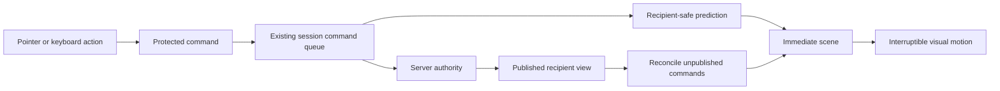

# PTCG sandbox experience review

The current client has a functioning interaction and motion foundation, but its
visual language and card handling remain inconsistent between the table, card
browser, inspector, deck editor and dialogs. This review extends ADR-027. The
goal is a responsive, tactile tabletop with readable cards and quiet, coherent
controls. It preserves the manual sandbox, existing shortcuts, recipient-safe
views and authoritative command queue.

## Research and design decisions

| Reference                                                                                                                                                                       | Observation                                                                                                                             | Application here                                                                                                                                                                                                  |
| ------------------------------------------------------------------------------------------------------------------------------------------------------------------------------- | --------------------------------------------------------------------------------------------------------------------------------------- | ----------------------------------------------------------------------------------------------------------------------------------------------------------------------------------------------------------------- |
| [Simon Goellner's holographic cards](https://poke-holo.simey.me/) and [project description](https://github.com/simeydotme/pokemon-cards-css)                                    | Pointer position drives layered glare, foil and perspective. Different finishes need different masks.                                   | Share card material variables across the board and inspectors; keep ordinary cards restrained, and settle the reading view after movement. Implement the technique independently.                                 |
| [Pokémon TCG Live 1.42.0 notes](https://community.pokemon.com/en-us/discussion/25821/version-1-42-0-patch-notes)                                                                | The official September 2026 fixes include animation unresponsiveness and VFX continuing after their accessibility setting was disabled. | Treat interruption, immediate input, and live reduced-motion changes as required behavior, not finishing touches.                                                                                                 |
| [Tabletop Simulator controls](https://kb.tabletopsimulator.com/player-guides/basic-controls/) and [context menus](https://kb.tabletopsimulator.com/player-guides/context-menu/) | Direct manipulation, alternate zoom, contextual actions and shortcuts coexist.                                                          | Preserve fast drag/key workflows; expose reading and search controls without forcing menus into common actions.                                                                                                   |
| [Limitless tools](https://www.limitlesstcg.com/tools)                                                                                                                           | Tabletop supports opening-hand practice and playing both sides, with drag and keyboard controls.                                        | Solo rehearsal, quick setup/reset, ordered searches and readable deck browsing are primary workflows.                                                                                                             |
| [Hearthstone UI talk](https://www.gdcvault.com/play/1022036/Hearthstone-How-to-Create-an)                                                                                       | Its UI presentation explicitly treats immersion as an interface design problem.                                                         | Give controls, cards and the table a consistent material language rather than adding unrelated effects. This is a design inference from the talk's published scope, not a claim to have watched the full session. |
| [Web animation guidance](https://web.dev/articles/animations-guide)                                                                                                             | Transform/opacity animations avoid the layout work associated with positional properties; permanent layer promotion has costs.          | Keep state geometry authoritative; animate presentation, with bounded lifetimes and no idle rendering loop.                                                                                                       |
| [Pixi performance guidance](https://pixijs.com/8.x/guides/concepts/performance-tips)                                                                                            | Filters, masks and changes of blend mode can be expensive.                                                                              | Keep the production DOM renderer; isolate foil work to the cards being handled. A renderer switch is not a prerequisite for the visual effects.                                                                   |
| [WAI modal dialog pattern](https://www.w3.org/WAI/ARIA/apg/patterns/dialog-modal/) and [WCAG 2.2](https://www.w3.org/TR/WCAG22/)                                                | Dialogs need managed focus; dragging needs alternatives; motion must be controllable.                                                   | Preserve focus return and keyboard actions, make controls visibly focusable, and support reduced motion across every material and animation.                                                                      |

Additional visual and workflow references:

- [Official TCG Live sneak peek](https://www.youtube.com/watch?v=7ooBE5AQODY):
  inspected the September 2021 trailer through extracted frames and a 250 ms
  sequence around the enlarged card/status presentation. The table anchors the
  two Actives centrally; raised cards and floating status effects draw attention
  to a particular object. Borrow the spatial continuity, but keep effects short
  and unobtrusive in a manual practice tool. This is prerelease footage, not an
  assertion about the current client.
- [Official prerelease screenshots archived by Serebii](https://www.serebii.net/tcglive/pics.shtml):
  inspected the February 2022 board and deck editor. The editor's large art,
  nearby quantity controls and quiet background informed the reading hierarchy.
- [Untap updates](https://www.untap.in/updates): searchable piles, duplicate
  counts, shortcuts and folding tools prioritize repeated practice operations.
  Search and density here are view operations; they never reorder the deck.
- [Card Game Simulator controls](https://www.cardgamesimulator.com/how-to-play/):
  manual card actions remain available through direct manipulation and context
  controls. Preserve that freedom instead of tying the UI to a rules engine.
- [Pokémon TCG Pocket](https://tcgpocket.pokemon.com/en-us/): collectible art can
  carry the visual identity. Keep the interface subordinate to the cards, and
  keep a still reading mode available. Its marketing page was inspected, not its
  installed application.

The TCG Live landing page blocked automated viewing; the 2023 trailer could not
be retrieved. The older official footage above was accessible. No claims here
depend on an unobserved current Live animation. Reference captures are outside
the repository, in `/tmp/ptcg-experience-review`.

## Code audit

| Area                | Finding                                                                                                    | Work                                                                                                 |
| ------------------- | ---------------------------------------------------------------------------------------------------------- | ---------------------------------------------------------------------------------------------------- |
| Renderer selection  | React DOM is the production default. Pixi remains an alternate.                                            | Preserve this choice; improve the engine players actually use.                                       |
| Board geometry      | Previous task made the halves equal and centered the Active, Bench and hand.                               | Preserve symmetry and manually adjustable split.                                                     |
| Design primitives   | UI buttons, panel buttons, overlay buttons and legacy chrome have separate sizes and timings.              | Shared control, surface and motion tokens; one consistent interaction treatment.                     |
| Visual hierarchy    | Many sidebar actions use equally strong saturated fills; chrome competes with cards.                       | Quiet secondary actions, clearer primary actions, refined table palette and typography.              |
| Card materials      | Board glare, inspector foil and modal glare are three independent implementations.                         | Shared material anatomy and variables; bounded pointer updates; readable resting state.              |
| Readability         | Zone browsers choose compact cards automatically. Users cannot choose density or search a pile.            | Add explicit card-size and search controls, preserving actual card order and command identity.       |
| Preview             | Large card view exists, but has no visible reading controls or close affordance.                           | Add an unobtrusive close/readability treatment without hiding the full card.                         |
| Drag                | Board uses captured pointer input, spring sway and release velocity; overlay dragging is native HTML drag. | Improve board grip/depth and audit overlay drag cancellation and next-action readiness.              |
| Shuffling           | Scene planner detects deck re-aliasing only.                                                               | Extend appropriate shuffle feedback without inventing concealed identities or random outcomes.       |
| Damage              | Changes pulse the counter but do not communicate the amount changed.                                       | Readable, restrained delta feedback with cleanup and reduced-motion support.                         |
| Board flip          | Visual table turns but separate chrome is outside the motion layer.                                        | Review continuity and interruption while keeping input coordinates stable.                           |
| Optimistic commands | Prediction, publication deduplication and rollback already exist.                                          | Verify the real delayed-server flows; preserve the authoritative queue and never predict randomness. |
| Modals and menus    | Base UI dialogs coexist with custom board menus and exit ghosts.                                           | Audit each focus/dismissal path; keep semantic lifetime independent of animation.                    |
| Assets              | GX, VSTAR, damage and conditions already have vector representations.                                      | Refine existing scalable assets instead of introducing mismatched low-resolution bitmaps.            |

## Verification plan

Review the actual room at 1280×720, 1440×900 and 1920×1080, plus narrow desktop,
fullscreen, both perspectives, Day/Night, reduced motion and instant speed.
Exercise deck import, setup, draw, discard, prize movement, search, sorting,
inspection, context actions, damage, conditions, coin, shuffle, board flip,
undo, multiplayer projection, delayed publication and reconnect.

Changes to stateful primitives require focused unit tests. Browser evidence must
cover final geometry, focus restoration, cancellation, no stale ghosts, no
concealed faces, and no animation gate on the next input. Run static checks and
the relevant existing regression lanes before delivery. Do not claim universal
perfection or performance measurements that were not made.

## Implemented experience

The table has equal halves, aligned Active centers and equal Bench widths. Both
GX/VSTAR groups are vertical and upright. The player frames keep their intended
opposite perspectives. Night uses graphite and restrained indigo; Day uses a
warm neutral mat. Stronger zone labels and quiet secondary actions make the
cards the most prominent elements. Inter Variable and Jost were already present
and remain appropriate; replacing the fonts alone would not fix hierarchy.

The sidebar collapses introductory help once a deck is loaded, while keeping
help and release notes accessible. Settings now have appearance/motion sections,
shared switches, a consistent background button and scrolling on short screens.

Card browsing adds search and Auto/Compact/Large sizes. Large cards reach 420 px
high when the viewport permits; the modal remains inside the board. Search only
uses labels already disclosed to this viewer. It filters a presentation list,
never the canonical list used for moves or shuffles. Clearing search restores
the original order. Escape clears a search before closing its browser.

The full-card preview uses high-resolution art, visible Close/Esc and Read card
controls in a separate row, so they do not cover the card's name or HP on narrow
tables. Read card removes perspective and light. The ordinary inspection mode
also settles to a flat card after 480 ms without pointer movement. The deck
builder's hover preview now scales with the viewport, up to 560 px high, instead
of remaining fixed at 360 px. Its large preview has a visible close control.

A card's pickup point controls the drag pivot. Horizontal and vertical velocity
drive restrained roll, pitch and yaw springs. Release settles the surface;
stopping the pointer stops scheduling frames once the spring rests. This is
visual depth, not a change to drop coordinates or command construction.

Deck riffles, card flights, face flips, counter pulses, coin motion and the board
turn already existed. This pass adds concealed-prize gather/shuffle/deal motion,
damage/healing amounts beside the persistent counter, immediate interruption
of the decorative board turn, and cancellation of card-specific effects when
that card is grabbed. It also closes missing animation cleanup paths. Instant
speed now disables hover tilt and drag sway as well as travel animations.

## Building blocks and ownership

| Primitive         | Contract and owner                                                                                                                                                                              |
| ----------------- | ----------------------------------------------------------------------------------------------------------------------------------------------------------------------------------------------- |
| Design tokens     | `design/tokens.css` owns palette, control geometry, radii, type, surface and motion values. Panel controls and overlay buttons share the new control-height and press values.                   |
| Card material     | `design/card-material.css` owns foil/glare layers and reading/reduced-motion overrides. Board, inspector and large preview supply pointer/light variables and intensity.                        |
| Finish descriptor | `renderer-contract/card-material.ts` provides a cosmetic `CardFinish`; the scene derives it only from disclosed definitions. Hidden backs get no face-specific finish.                          |
| Card pose         | `DragSwing` changes only the visual body. `HoverTilt` and overlay tilt own pointer light. The drag controller continues to own capture, gesture state and coordinates.                          |
| Motion plan       | `renderer-contract/motion-plan.ts` consumes recipient-safe previous/next scenes. Prize motion uses anonymous visible backs, never a pairing of hidden identities.                               |
| Motion lifetime   | `BoardMotionDirector` tracks flights, ghosts, extra animations and per-card effects. Replacement, interruption, instant mode and disposal can cancel them.                                      |
| Dialogs           | Existing Base UI dialogs keep focus, asynchronous validation and semantic dismissal. Shared custom-surface focus handling now covers previews, help sheets and the custom-card form.            |
| Menus             | Board menus retain their protected controller paths. Room menus now share arrow/Home/End navigation, Escape dismissal and focus return. Language menus retain their existing keyboard behavior. |

The shared material has three treatments: sheen, art-box holo and rainbow. It
uses independent gradients, glare and blend layers, inspired by the reference
technique; no source was copied from the GPL project. Finishes are currently
inferred from disclosed names/categories, **not print-accurate rarity data**.
Ordinary Pokémon use the standard art-box mask, which will not perfectly match
every historical card layout. A per-print material catalog can replace that
heuristic without changing card interaction or authority.

The production renderer is React DOM, despite Pixi being available. Effects in
this pass target the actual production path; the shared descriptor is available
to a future Pixi material implementation. No Pixi shader or new render loop was
introduced. A renderer migration needs separate measurement, especially for
filter bounds, texture lifetime, blend batching and low-end devices.

### Optimistic state and animation

The existing `BoardSessionAdapter` folds unpublished pending commands over the
latest authoritative view. Published commands are not applied twice; rejection
removes their predictions and produces rollback motion. This architecture was
retained and tested, not rewritten gratuitously. Predict only information the
viewer may already know. Random outcomes and concealed identities remain under
authority. The next input never waits for an animation promise.

The delayed-server browser scenario holds room messages, performs local actions,
then releases publication. It passes: feedback appears while the room is silent
and remains consistent afterward. Server/runtime tests cover the existing
command and continuation machinery; no server protocol changed in this pass.

### Surface audit

| Surface / call sites                                            | Result                                                                                                                |
| --------------------------------------------------------------- | --------------------------------------------------------------------------------------------------------------------- |
| `ui/DialogHost`, `Dialog`, `ToastViewport`, `Tooltip`           | Retained shared semantic primitives, queueing, focus return and animated surfaces; new tokens propagate through them. |
| Board context/category menus, marker/count/confirmation prompts | Preserved protected commands, keyboard navigation and confirmation behavior; exercised by unit and browser suites.    |
| Zone browser and work-area panels                               | Search/density added to zone browsers. Work-area identity, native drag and teardown remain covered by existing tests. |
| Single-card and stack previews                                  | Single-card reading/close controls added. Stack preview geometry and modal boundary retained.                         |
| Deck builder search, custom card, card preview, CSV/review      | Adaptive hover art, explicit preview close and focus boundaries. Import validation and review semantics retained.     |
| Solo/multiplayer/replay options                                 | Shared keyboard menu handling; existing leave/reset/export/restore dialogs retained.                                  |
| Welcome, shortcuts and release notes                            | Compact persistent help access; content clicks no longer dismiss the help sheet; focus remains inside it.             |
| Board markers and chrome                                        | Symmetric containers and upright GX/VSTAR controls, existing scalable artwork, new damage amount feedback.            |

## Validation results

Completed checks:

- Static gate: formatting, ESLint, TypeScript (app, model, runtime, browser and
  tooling), module boundaries, public API report and dependency cycles passed.
- Web and Worker production builds and bundle-boundary checks passed.
- Unit suite: 2,636 cases across 270 files exercised. The last full run passed
  2,635; its remaining assertion expected the old settings copy. Updating that
  expectation and rerunning the complete affected 17-test lobby file passed.
- Tooling: 49 tests passed. Legacy: 79 tests passed. Server runtime: 32 tests
  passed across the authority and continuation lanes.
- The 210-case Chromium run passed 207 immediately. The two old expectations
  for zone-browser tab order and settings copy were updated and their complete
  scenarios passed on rerun. The long resource-churn case passed in 5.5 minutes
  after restarting the development server and freezing source edits: 140
  setup/reset cycles and 560 pile-browser openings. Earlier runs were interrupted
  during live development and by termination of the local Vite process; they are
  not counted as successful checks. The separate six-cycle animated churn passed
  with no remaining ghosts, flying cards or running animations.
  The long run checks stable post-GC document/node/listener counts, retained heap
  within 10% of its warmed baseline, renderer identity and one active game socket.
- Three new Chromium scenarios passed: readable search/density and preview
  focus; prize re-aliasing, grip and instant motion; menu/custom-dialog keyboard
  handling. The foil assertion keeps the pointer moving while sampling, since
  a single hover legitimately fades before a delayed sample can observe it.
  The final preview adjustment passed these scenarios again, plus both overlay
  paint scenarios; narrow-screen controls are checked for zero card overlap.
- Firefox passed the full Solo journey and all three new interaction scenarios.
  Its cached browser ran with existing Nix library paths supplied locally.
- Production-origin preview, online save/restore and continuation drain passed.
  The save/restore test now polls the sender's published revision: different
  sockets do not receive publication simultaneously. Product authority behavior
  was not changed to satisfy that timing assumption.
- WebKit could not launch because this host lacks required runtime libraries
  (including ATK/WPE dependencies). WebKit compatibility is not certified here.

Manual review captures include populated 1024×768, 1440×900 and 1920×1080 tables,
both themes, the deck editor, settings, searched large cards, moving foil and the
flat reading view. Actual Active bounds have the same x, width and height on
both sides at each measured size. Browser checks additionally cover flip,
fullscreen, scaled layouts, touch boundaries and concealed-asset privacy.

## Limits and next visual decisions

- This is an implemented redesign pass and a reusable foundation, not a claim
  that every subjective choice is final. The manual sandbox has no added rules
  automation.
- The existing GX/VSTAR and condition artwork is retained. No new low-resolution
  counter images or unverified asset pack was introduced.
- Holo finishes are cosmetic. Exact per-print foil masks and real foil textures
  need a card-art metadata source and a separate visual pass.
- Native HTML dragging remains in browser/work-area overlays. Replacing it with
  the board pointer controller would require careful cross-surface capture and
  accessibility work; it was not silently replaced here.
- Headless browser checks are functional evidence, not a hardware GPU frame-rate
  certification. No claim of universal 60/120 fps or zero bugs is made.
- Mobile is still subject to the existing desktop-oriented product boundary.
  Desktop and narrow desktop were reviewed; a fully touch-first phone layout is
  a separate product design.
